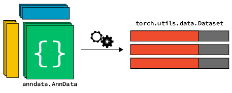

# 

[](https://pypi.python.org/pypi/torch-adata/)
[](https://badge.fury.io/py/torch-adata)
[](https://torch-adata.readthedocs.io/en/latest/?badge=latest)
[](https://github.com/psf/black)

Create [`PyTorch Datasets`](https://pytorch.org/tutorials/beginner/basics/data_tutorial.html) from [`AnnData`](https://anndata.readthedocs.io/en/latest/)

## Installation

Install from PYPI (current version: **[`0.0.24`](https://pypi.org/project/torch-adata/)**):
```BASH
pip install torch-adata
```

Install the developer version:
```BASH
git clone https://github.com/mvinyard/torch-adata.git; cd torch-adata;
pip install -e .
```

## The main API

The primary class is the [`AnnDataset`](https://github.com/mvinyard/torch-adata/blob/main/torch_adata/_core/_AnnDataset.py). This is a subclass of the widely-used [`torch.utils.data.Dataset`](https://pytorch.org/tutorials/beginner/basics/data_tutorial.html). The PyTorch `Dataset` module enables us to take advantage of built-in multiprocessing and other organizational tricks that ultimately standardize workflows and enable reproducibility.



```python
import anndata as a
import torch_adata

adata = a.read_h5ad("/path/to/data.h5ad")
dataset = torch_adata.AnnDataset(adata, use_key="X_pca", groupby="time", obs_keys=["affinity"])
```
```
[ torch-adata ]: AnnDataset object with 7131 samples
----------------------------------------------------
Grouped by: 'time' with attributes:
 - X (use_key = 'X_pca') torch.Size([3, 7131, 50])
 - obs: affinity: torch.Size([3, 7131, 1])
```

#
There is an additional approach to this dubbed [`AnnLoader`](https://github.com/scverse/anndata/blob/master/anndata/experimental/pytorch/_annloader.py), highlighted by [Sergei Rybakov](https://github.com/koncopd) in [Interfacing pytorch models with anndata](https://anndata-tutorials.readthedocs.io/en/latest/annloader.html)


**For more information, please visit the [documentation](https://torch-adata.readthedocs.io/en/latest/index.html)!**

**Problem?** Open an [issue](https://github.com/mvinyard/torch-adata/issues/new)

### Shared categorical observations

`AnnDataset` one-hot encodes object, string, and string-valued pandas categorical observation
columns using one vocabulary per `obs_keys` entry. Vocabularies are established
from all input observations **before** grouping or padding, so each tensor column
has the same meaning at every timepoint. Inferred vocabularies contain sorted,
observed labels; unused pandas category declarations are not included.
Numeric observations (including numeric pandas categoricals) retain their values unless selected with `one_hot=True`
(or a per-column list of flags).

The resolved mapping is available as `dataset.category_vocabularies`. Reuse it
when constructing datasets from separate subsets:

```python
full = AnnDataset(adata, use_key="X_pca", obs_keys=["cell_type"])
subset = AnnDataset(
    adata[subset_mask],
    use_key="X_pca",
    obs_keys=["cell_type"],
    category_vocabularies=full.category_vocabularies,
)
```

You may instead supply a mapping such as
`{"cell_type": ["B", "T", "monocyte"]}` to specify column order, including
categories absent from the current input. Supplied sequences are copied; missing
mapping entries are inferred. Categorical missing values (`None`, `NaN`, `pd.NA`)
and labels outside a supplied vocabulary raise `ValueError`. Represent missing
labels with an explicit category beforehand if they should be encoded.

`LightningAnnDataModule` automatically establishes and caches a shared vocabulary
from its complete AnnData on first dataset access, reusing it for train,
validation, test, and prediction datasets. It also accepts
`category_vocabularies=...` for an external schema. Sharing this label metadata
does not change split membership or move observations between splits. New labels
introduced after the schema is established raise an error; construct a new module
when the vocabulary changes. This represents labels in batches; it does not add
supervision, label-conditioned dynamics, or batch correction.

Run the regression suite with `python -m pytest` (requires pytest).
